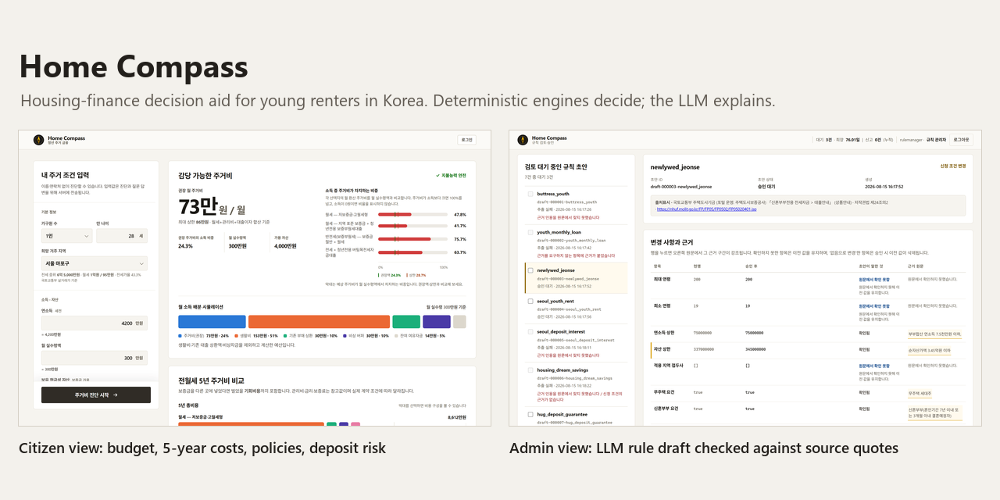

# Home Compass

[](https://github.com/dnhynk/Home_Compass/actions/workflows/ci.yml)

Home Compass helps young renters in Korea choose a lease they can afford: it sets a monthly housing budget, compares the five-year cost of jeonse (a lump-sum deposit lease) and wolse (monthly rent), checks eligibility for public housing-finance programs and scores the risk of losing a deposit.

Four deterministic engines compute every amount and verdict, the LLM calls them as tools to explain the results, and a policy rule the LLM drafts takes effect only after its source quotes pass a verbatim check and a rule manager approves it.



Left: the citizen view for the sample profile in Results. Right: rule review. Four of the seven LLM drafts in the queue failed the evidence check, and the open draft raises an asset cap from 337 to 345 million won, citing "순자산가액 3.45억원 이하" (net assets of 345 million won or less). The UI is in Korean. Full size: [citizen view](docs/images/citizen.png), [rule review](docs/images/rule-review.png).

## What it does

- Budget: a maximum and a recommended monthly housing cost after living costs, existing debt payments and an emergency buffer.
- Five-year cost: four lease options, from low-deposit wolse to loan-financed jeonse, compared by total cost, net present value and monthly equivalent. Loan interest, maintenance fees, deposit guarantee fees and the opportunity cost of the deposit are included.
- Program eligibility: the profile is checked against 8 housing-finance programs, with a pass or fail reason for each criterion.
- Deposit risk: a 0 to 100 score from five factors, including the deposit-to-price ratio, the loan share of the deposit and whether a return guarantee is available.
- Staff screens: counselors can see internal fields such as rule versions and can flag data errors. Only the rule-manager role can approve or reject LLM-drafted rule changes (`backend/src/home_compass/auth.py`), and every decision goes to an append-only audit log.

## How it works

- Engines: `backend/src/home_compass/engines/` holds the four engines, written as pure functions (no I/O, and the clock is passed in): `affordability.py` (monthly housing-cost cap), `tco.py` (five-year cost per lease option), `eligibility.py` (program eligibility) and `risk.py` (deposit risk). Every constant is passed in from the registry in `contracts/model_constants.json`. `backend/tests/crosscheck/test_architecture.py` parses the imports and fails if `engines/` imports the LLM, store, ingest, auth, config or API modules.
- Chat: `backend/src/home_compass/llm/agent.py` gives an OpenAI or Anthropic model the four engines as tools, and its system prompt requires every number in a reply to come from a tool result. Without an API key, a fixed template writes the reply from the same engine output.
- Rule drafts: `backend/src/home_compass/llm/extraction.py` asks a model to turn a policy document into a draft rule with a source quote for each field. `backend/src/home_compass/ingest/extraction_verify.py` rejects the draft if the schema fails, a field has no quote, or a quote is not found character for character in the stored text (`backend/tests/ingest/test_extraction_verify.py`). The review screen shows each quote in the source and how the verdicts for 12 test profiles would change. The draft becomes a new rule version only when a rule manager approves it (`backend/tests/api/test_admin_review.py`).
- Browser port: `frontend/local_engine.js` reimplements the engines in JavaScript, so the citizen page still computes results when the API is unreachable. It reads constants, policies and regions from `frontend/generated/`, which `scripts/gen_contracts.py` writes from the backend's sources. `backend/tests/test_frontend_local_engine_equivalence.py` runs the JavaScript port under Node and compares its numbers, policy reasons and data lineage with the Python engines.
- Provenance: each analysis lists the source, observation time and verification status of every fact it used, plus a data grade set by the weakest fact (`contracts/provenance.schema.json`, `backend/tests/api/test_analyze_lineage.py`). Unverified values stay in the response and lower the grade.

Start reading here: `backend/src/home_compass/engines/` and `backend/tests/crosscheck/test_architecture.py`. `backend/src/home_compass/main.py` is large (about 181 KB, 3,860 lines) and holds every API route.

## Results

- CI (GitHub Actions, Ubuntu, Python 3.13) runs `pytest backend/tests` on every push to main. On commit 698eb0f (2026-09-21) it reported 2,446 passed and 2 skipped. A local run on 2026-10-31 (Windows 11, Python 3.13) gave the same counts.
- Engine parity: 12 regression profiles, each run as written and in all 10 seeded regions, give 132 cases. The Python engines and `frontend/local_engine.js` return the same numbers in all 132 and the same policy reasons and lineage in the 131 cases with a valid region code. Both reject the invalid one.
- Rule extraction: the seeded batch (gpt-5.4-mini, 7 policy documents, 2026-08-16 KST) produced 3 drafts that passed verification and 4 that were rejected. Three quoted text that is not in the source, and one attached a quote to a field that takes none. Two reruns of the same batch passed 3 and 5 of 7. The first run is stored unedited in `backend/src/home_compass/data/rule_drafts.json`.
- Sample analysis, as in the screenshot: age 28, one-person household, no home owned, works at a small or medium business, Mapo-gu in Seoul, 42 million won a year, 3 million won take-home pay a month, 40 million won in savings, 300,000 won a month in debt payments. Result: 730,000 won a month recommended and 860,000 won maximum, with 4 programs eligible, 1 conditional and 3 not eligible.

## Status and limitations

- Contest MVP. Maintenance stopped in September 2026 and the demo used for judging is offline, so run it locally.
- The 8 program rules hold sample figures that may differ from current program terms. Market data for 10 regions comes from the real-transaction API of MOLIT (Korea's Ministry of Land, Infrastructure and Transport), fetched on 2026-08-15 and frozen. Three of its eight fields (maintenance fee, market risk, guarantee availability) are example values. These unverified inputs put every analysis at grade C.
- Results are information only. They are not approval of a loan or other financial product, legal or tax advice, or an investment recommendation. Before signing a contract, check the latest official texts and guidance from the institutions involved.
- Of the 83 model constants, 71 are judgment calls with no single correct value. `backend/tests/artifacts/sensitivity.md` shows which verdicts flip when each is moved by 5% or 20%.
- Nothing checks the chat text after the model writes it. A reply can misquote a number, but the result cards always show the engine output.
- The review queue holds one frozen extraction batch. Collecting new policy notices and re-extracting them is not automated.
- Login sessions live in process memory, so the server must run as one process with one worker.

## Run it

Python 3.11 or newer (CI uses 3.13). No API key is needed. From the repository root:

```bash
python -m pip install -r backend/requirements.txt
python scripts/seed_store.py
cd backend/src && python -m uvicorn home_compass.main:app --port 8000 --workers 1
```

On Windows, `scripts\dev.bat` does the same in one step but runs the full test suite first, so it also needs Node.js and `pip install -r docs/competition/requirements.txt`.

Open http://127.0.0.1:8000/ for the citizen view and http://127.0.0.1:8000/admin/ for staff. `http://127.0.0.1:8000/api/health` should return `{"status":"ok","llm":"offline",...}`.

On first start the server creates the `counselor` and `rulemanager` accounts and prints a random password for each to stderr, once. To choose them, set the environment variables `HOME_COMPASS_SEED_COUNSELOR_PASSWORD` and `HOME_COMPASS_SEED_RULE_MANAGER_PASSWORD` before the first start (values in `.env` are ignored). For a live chat model, copy `.env.example` to `.env` and set `OPENAI_API_KEY` or `ANTHROPIC_API_KEY`.

The test suite takes a few minutes and needs Node.js on the PATH. Without it, the JavaScript tests, including the parity test, fail.

```bash
pip install -r docs/competition/requirements.txt
python -m pytest backend/tests -q
```

## Docs

- [Design spec](docs/engineering/SPEC.md) (in Korean): scope, where the LLM may act, data lineage and acceptance criteria.
- [Contracts and model constants](contracts/README.md) (in Korean): the JSON schemas, the constant registry and the decisions behind them.
- [Source research](docs/engineering/diligence/FINDINGS.md) (in Korean): where each constant and program condition comes from.
- [Policy document sources](docs/engineering/collection/SOURCES.md) (in Korean): the collected documents, their reuse terms and attribution.
- [Contest technical deck](docs/competition/%EA%B8%B0%EC%88%A0%EC%84%A4%EB%AA%85%EC%84%9C_Home_Compass.pptx) (in Korean, 19 slides).

## Project context

Solo entry to the 2026 Financial AI Challenge, organized by Korea's Financial Security Institute. I built it in August and September 2026 for the preliminary round (deadline 2026-09-07). The first commit imports my earlier prototype of the same app from a private repository. I am the only human contributor to both.

I wrote the specification and acceptance criteria and decided what shipped. Claude Code and Codex wrote most of the code. Commits made through Claude Code carry Co-Authored-By trailers.

## License

The code and the documents written for this project are under the MIT License (see [LICENSE](LICENSE)). The seven policy texts in `data/policy_sources/` are Korean public-sector documents and keep their own reuse terms, listed with attribution in the sources document above.
